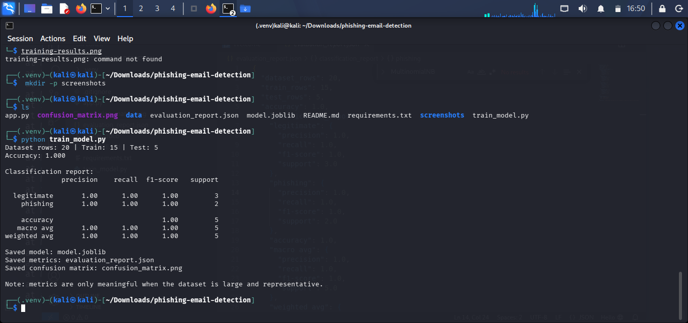
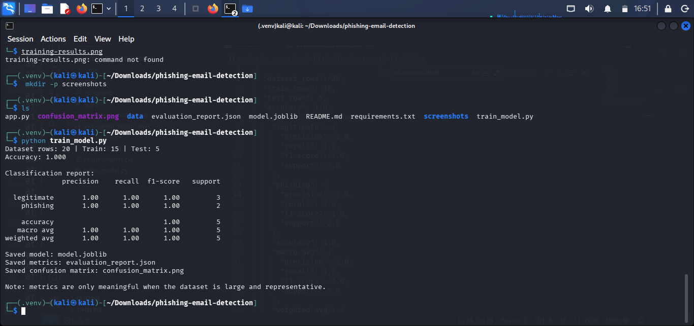
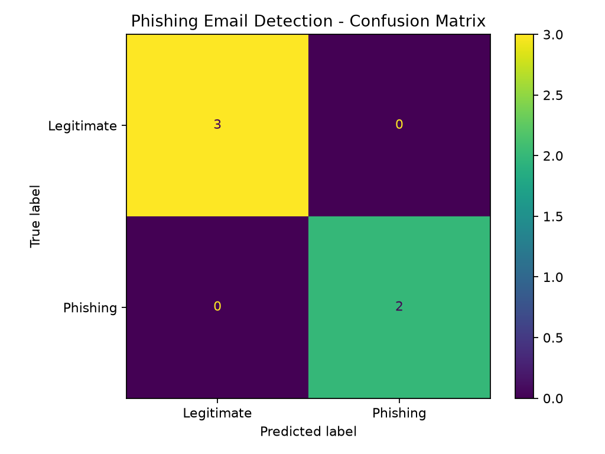

# Phishing Email Detection Using Machine Learning

An educational Python project that classifies an email text as **phishing/suspicious (1)** or **likely legitimate (0)** using TF-IDF features and a Multinomial Naive Bayes classifier.

## Important limitation

The included CSV is a tiny demonstration dataset written for learning. Scores from it are not evidence of real-world detection capability. Email text alone is not enough to prove a message is safe or malicious. Do not use this as a production email filter.

## Features

- Text preprocessing and TF-IDF feature extraction
- Multinomial Naive Bayes classification
- Train/test split with stratification
- Accuracy, precision, recall, F1-score, and confusion matrix
- Interactive command-line prediction
- Saved model and evaluation report (generated locally)

## Requirements

- Python 3
- pip
- Kali Linux or another Python-supported operating system

## Setup on Kali Linux

```bash
sudo apt update
sudo apt install -y python3 python3-venv python3-pip
cd phishing-email-detection
python3 -m venv .venv
source .venv/bin/activate
python -m pip install --upgrade pip
pip install -r requirements.txt
```

If Kali reports an externally-managed-environment error, keep using the virtual environment above; do not use `sudo pip`.

## Train and evaluate

```bash
python train_model.py
```

This creates `model.joblib`, `evaluation_report.json`, and `confusion_matrix.png`. These generated files are ignored by Git intentionally.

## Try an email

```bash
python app.py
```

Paste a message when prompted. Enter a blank line to exit.

## Dataset format

`data/emails.csv` must contain:
- `text`: email body or subject/body text
- `label`: `1` for phishing, `0` for legitimate

For a meaningful evaluation, replace the demo rows with a reputable, legally usable, labeled dataset. Remove personal information and keep a held-out test set. Avoid training and testing on duplicate or near-duplicate messages.

## Suggested GitHub repository contents

```text
phishing-email-detection/
├── app.py
├── train_model.py
├── requirements.txt
├── README.md
├── .gitignore
└── data/
    └── emails.csv
```

Do not commit real emails containing private data, credentials, API keys, or the generated model unless you have a specific reason.

## Screenshots

### 1. Model Training and Evaluation


### 2. Email Prediction Example


### 3. Confusion Matrix


## Ethical use

Use only data you have permission to process. Treat predictions as triage hints, not a definitive security verdict.
